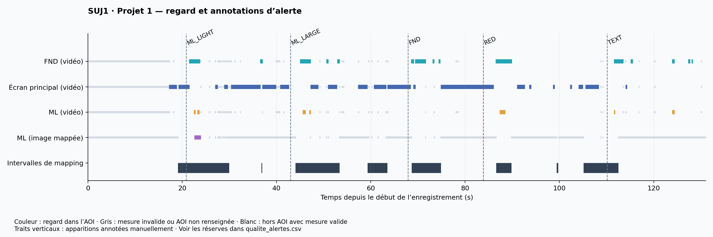
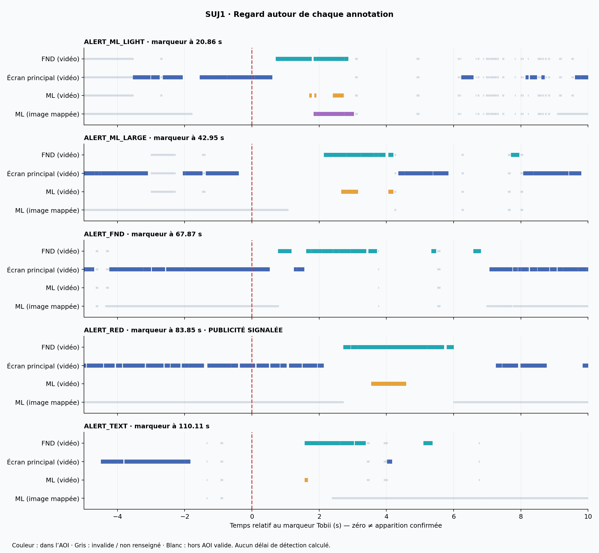
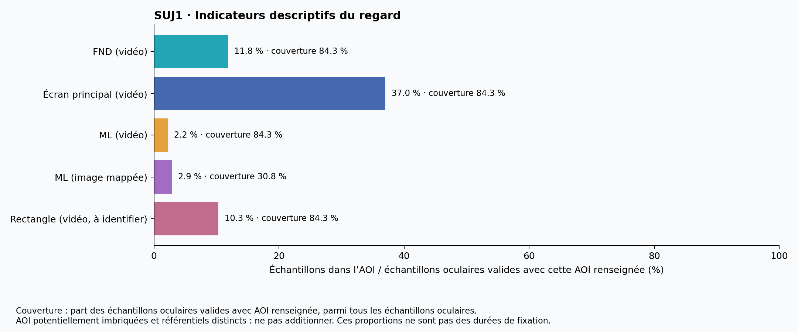
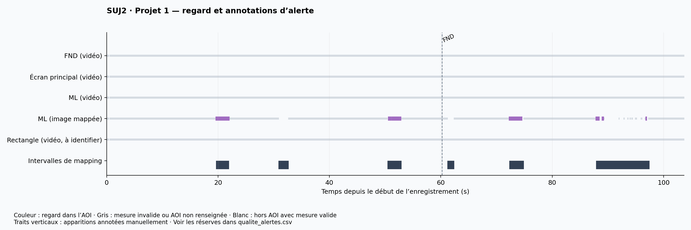
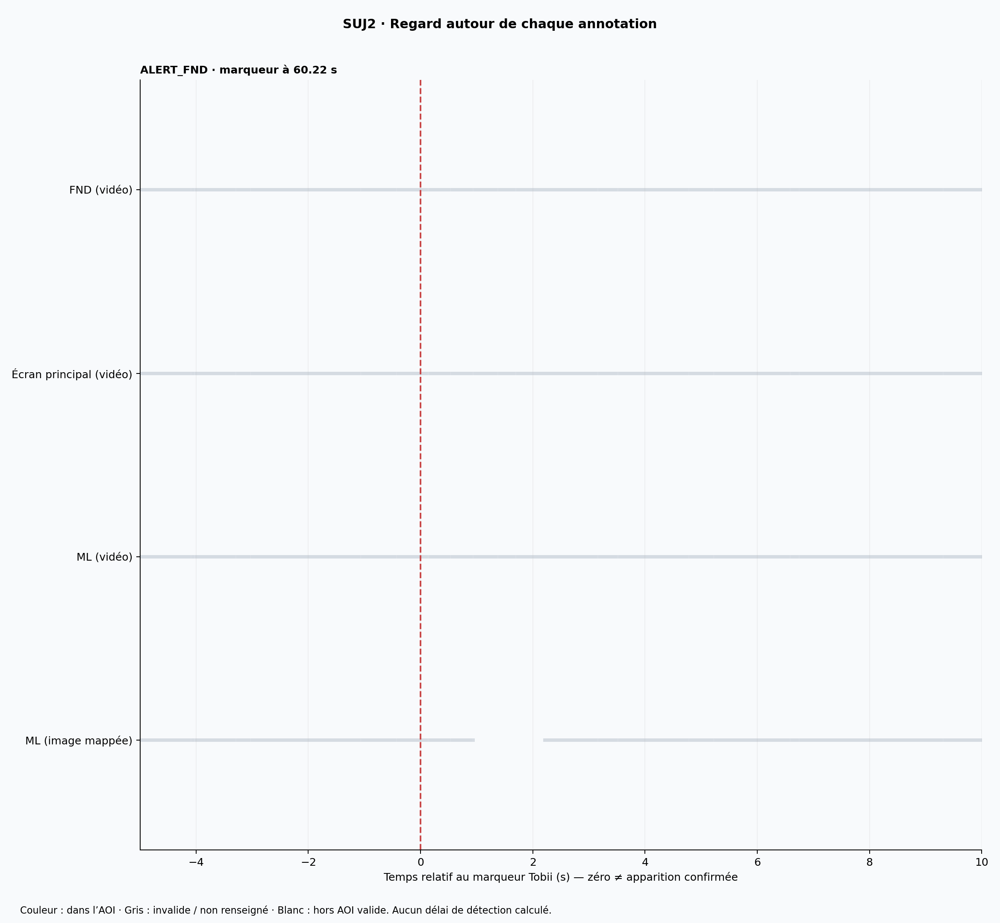
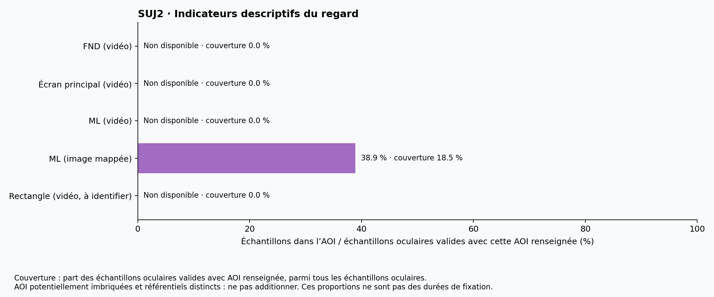
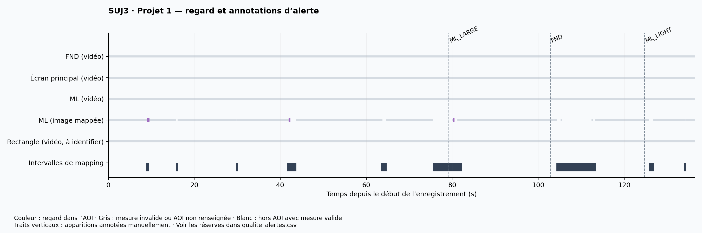
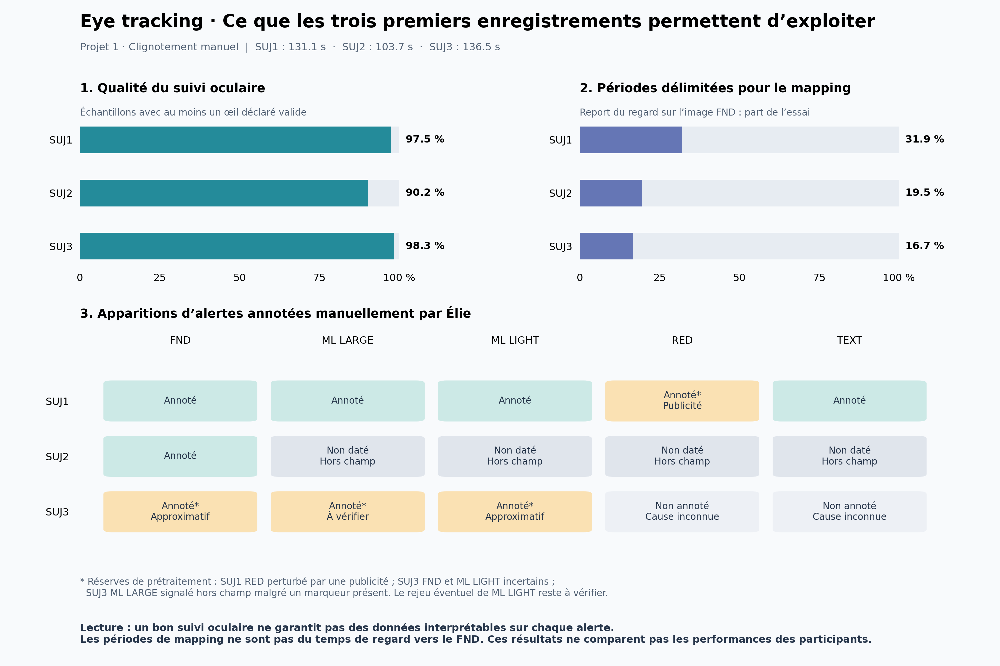
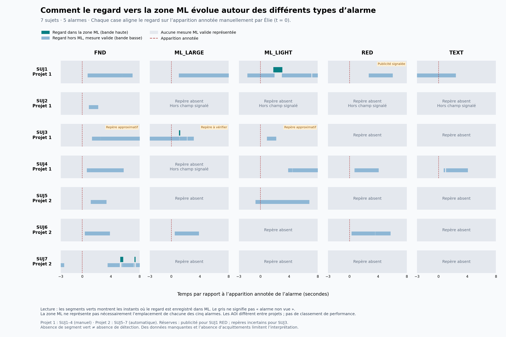
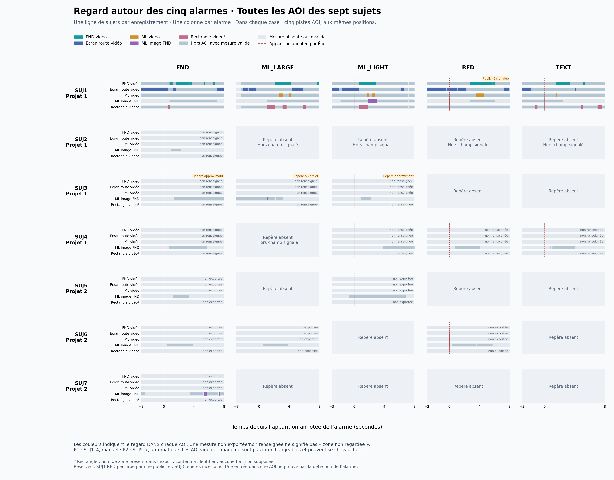

# Démonstration eye tracking — FND

Analyse exploratoire des sept sujets : **SUJ1 à SUJ4, projet 1** (clignotement manuel),
et **SUJ5 à SUJ7, projet 2** (clignotement automatique).
Le participant surveille une route sur l'écran principal et doit détecter les
alertes sur la tablette représentant le FND. Le projet 2 (automatisation Figma)
n'est pas encore analysé. Aucun résultat ne constitue une évaluation de compétence pilote.

## Figures déjà générées





Les versions SVG sont disponibles pour les présentations. Les CSV agrégés et
`resume.json` donnent les valeurs numériques et les dénominateurs.

## Premiers constats

- Durée : 131,058 s ; 12 956 échantillons oculaires, pas médian 10,027 ms.
- Au moins un œil déclaré valide : 97,55 % des échantillons oculaires.
- Huit intervalles annotés de mapping du FND : 41,846 s, soit environ 31,9 %
  de l'enregistrement. Ce chiffre ne mesure pas directement la visibilité du FND.
- Cinq annotations d'alerte présentes. Les apparitions ont été annotées manuellement par Élie ;
  leur précision dépend des réserves de prétraitement. Les acquittements restent
  à récupérer ; aucun délai de détection n'est calculé.
- `ALERT_RED` : publicité signalée dans les notes de prétraitement.

## Méthode et limites

Seules les lignes `Sensor = Eye Tracker` servent aux indicateurs du regard :
les lignes gyroscope/accéléromètre ne doivent pas gonfler les effectifs.
Un échantillon est retenu si au moins un œil est `Valid`. Pour chaque AOI,
les valeurs 0 et 1 sont interprétées comme hors/dans l'AOI ; -1 et les cellules
vides comme non renseignées. Le pourcentage est calculé sur les échantillons
oculaires valides pour lesquels **cette AOI** est renseignée. La couverture
rapporte ce dénominateur à tous les échantillons oculaires.

Les AOI vidéo FND, Main screen et ML sont distinctes de l'AOI ML sur l'image
mappée `HLX FND1`. Elles peuvent être imbriquées ; ne pas additionner leurs
pourcentages ni assimiler les référentiels. L'AOI `Rectangle`, de signification
inconnue, est affichée sans interprétation dans la vue de toutes les AOI. `HLX FND1` est aussi un nom de média/mapping dans
cet export : il n'est pas traité comme une colonne AOI supplémentaire.

Les graphiques représentent des échantillons de regard, pas des fixations
identifiées. Aucun temps de fixation n'est déduit du nombre de lignes.
Les traits gris regroupent données invalides et AOI non renseignées ; ils ne
permettent pas d'affirmer que le FND était hors champ. Les intervalles de mapping
ne constituent pas non plus une preuve de visibilité continue ou de fixation.
Regarder une zone ne prouve ni détection consciente ni compréhension.

Un seul sujet ne permet aucune comparaison manuel/auto ou généralisation.
Les notes de prétraitement des autres sujets seront intégrées quand leurs
exports seront disponibles. Les événements de synchronisation exportés sont
conservés dans le fichier source mais ne sont pas associés à Figma sans preuve.

## Relancer sans Python sur son ordinateur

Demander à l'assistant de lancer l'analyse dans le cloud en fournissant l'Excel,
ou ouvrir `notebooks/analyse_colab.ipynb` dans Google Colab et exécuter les cellules.
L'utilisation de Colab implique un transfert de données à ce service : utiliser
uniquement des données dont le transfert est autorisé par Airbus.

Pour l'environnement cloud :

```bash
cd /workspace/AirbusHelico
python3 -m pip install -r requirements.txt
python3 scripts/analyse_tobii.py /chemin/SUJ1.xlsx --output results/SUJ1
```

Le script prend en charge les schémas des exports SUJ1 à SUJ7 et attend, un seul sujet/enregistrement et une seule
feuille ; les futurs exports nécessiteront une vérification des noms d'AOI.
La réserve « publicité » est spécifique à SUJ1 et ne doit pas être propagée aux
autres sujets. Ne pas réutiliser ce script sans adaptation pour un autre sujet.

## Gestion des données

L'Excel original n'est pas versionné. `data/`, les Excel, vidéos et les CSV
échantillon par échantillon sont exclus de Git. Les sorties suivies contiennent
uniquement des temps relatifs, des identifiants SUJ1 à SUJ7 et des indicateurs descriptifs, sans noms,
dates d'acquisition ou captures. Il s'agit de pseudonymisation et non d'une
garantie d'anonymat. Conserver la correspondance des participants chez Airbus.
Vérifier les règles Airbus et la visibilité du dépôt avant d'ajouter des données
brutes ou d'autres données de participants.

## Suite attendue

Récupérer les temps Figma d'affichage et d'acquittement avec identifiants de
session/alerte et un repère commun à Tobii. Examiner ensuite la synchronisation,
la couverture autour de chaque événement et les réserves des essais avant
de calculer des délais. Pas de carte de chaleur sans image de référence et
validation des coordonnées mappées.

## SUJ2 — données disponibles

- 103,687 s ; 10 124 échantillons oculaires ; au moins un œil valide : 90,22 %.
- Six intervalles de mapping : 20,216 s (19,5 % de l’enregistrement).
- Une seule annotation : ALERT_FND à 60,219 s. Les quatre autres alertes sont
  absentes de l’export et signalées hors champ dans les notes de prétraitement.
  Ne pas les interpréter comme des alertes non détectées ou non présentées.
- Les colonnes AOI vidéo « Recording 5 » sont non renseignées pour SUJ2 ; ce
  sont des colonnes présentes dans l’export, sans données exploitables ici.
- Seule ML sur l’image mappée fournit des valeurs : 727 échantillons dans l’AOI
  parmi 1 870 valides et renseignés (38,88 %), couvrant seulement 18,47 % des
  échantillons oculaires. Ce résultat conditionnel ne mesure pas le regard
  sur l’ensemble de l’essai et ne permet pas une comparaison de performance.





```bash
python3 scripts/analyse_tobii.py /chemin/SUJ2.xlsx --subject SUJ2 --output results/SUJ2
```

`qualite_alertes.csv` distingue les marqueurs présents et les réserves connues
pour chacune des cinq alertes attendues. Les heures des alertes absentes ne
sont pas reconstruites. Les réserves sont propres au sujet : la publicité ne
concerne que SUJ1. Les fichiers source et échantillons individuels restent exclus de Git.

## SUJ3 — données disponibles

- 136,471 s ; 13 444 échantillons oculaires ; au moins un œil valide : 98,30 %.
- Trois apparitions annotées manuellement par Élie : ML_LARGE à 79,207 s,
  FND à 102,800 s et ML_LIGHT à 124,730 s.
- ML_LARGE est signalé hors champ dans les notes malgré la présence d'un marqueur :
  incohérence à vérifier. FND est approximatif ; ML_LIGHT comporte des notes
  hors champ et approximatives avec un rejeu possible. L'export ne contient
  qu'un marqueur ML_LIGHT et ne permet pas de confirmer ce rejeu.
- Aucun marqueur RED ou TEXT ; la cause de leur absence n'est pas documentée.
- Neuf périodes de report du regard sur l'image FND : 22,791 s. Il ne s'agit
  pas du temps de regard vers la tablette.
- Les trois AOI vidéo sont non renseignées ; seule ML sur l'image de référence
  fournit des mesures : 56 échantillons dans la zone sur 2 163 valides et renseignés
  (2,59 %). Ce dénominateur ne couvre que 16,09 % des échantillons oculaires.
  Aucune comparaison de performance entre participants ne peut en être déduite.



Les figures complètes et tableaux se trouvent dans `results/SUJ3/`. Les figures
actuelles sont des sorties techniques exploratoires, à simplifier pour une
présentation Airbus ; les zones absentes ne constituent pas une absence de regard.

```bash
python3 scripts/analyse_tobii.py /chemin/SUJ3.xlsx --subject SUJ3 --output results/SUJ3
```

Les mentions des marqueurs ont été corrigées dans les figures des trois sujets :
il s'agit d'annotations manuelles d'apparition, pas d'événements Figma importés.

## Figure comparative — disponibilité des données



Cette figure compare la qualité du suivi oculaire, la proportion de chaque
essai délimitée pour le mapping et la disponibilité des annotations manuelles
d’alertes. Elle ne compare pas la performance des participants. Les trois
pourcentages de mapping utilisent chacun la durée totale de leur enregistrement
comme dénominateur : SUJ1 31,9 %, SUJ2 19,5 %, SUJ3 16,7 %.
Les réserves du tableau viennent des notes de prétraitement, distinctes des
mesures du regard. Les formats SVG et PDF sont fournis pour les présentations.

```bash
python3 scripts/comparer_sujets.py
```

Le script découvre les dossiers `results/SUJ*` contenant les résultats
préalablement analysés. Les futurs sujets nécessitent d’abord leur propre
analyse et la saisie de leurs réserves ; ne pas appliquer automatiquement
le profil d’un sujet à un autre.

## Projet 2 — clignotement automatique : SUJ5, SUJ6, SUJ7

Ces trois fichiers appartiennent au projet 2, conformément aux indications de
l’utilisatrice et au champ `Project name = Project2` de chaque export.

Une seule AOI est exportée : `AOI hit [HLX FND - HLX_FND_ML]`, sur le média
`HLX FND`. Le projet 1 utilise un autre média (`HLX FND1`) et une autre
définition de colonne AOI. L’équivalence géométrique des zones n’est pas
établie : leurs proportions de regard ne permettent pas de conclure à un effet
du mode de clignotement. Les zones vidéo du projet 1 ne sont pas inventées
pour les exports du projet 2.

Les en-têtes de temps du projet 2 n’indiquent pas d’unité. Le script interprète
les horodatages en microsecondes et vérifie leur cohérence avec le champ durée
en millisecondes (écart maximal 1 %). Il s’arrête en cas d’incohérence. La
durée déclarée est utilisée pour l’axe et la couverture de mapping. Le dernier
horodatage exporté est conservé séparément : SUJ6 se termine environ 0,543 s
avant sa durée déclarée, sans extrapoler des échantillons sur cette fin.
Les en-têtes Unicode sont normalisés.

Les anciennes notes SUJ5–SUJ7 ne précisaient pas le projet : elles ne sont pas
appliquées automatiquement à ces exports. Les absences de marqueur restent
« cause non documentée » tant que leur correspondance n’est pas confirmée.
Des marqueurs ML_LARGE et RED existent notamment dans SUJ6 ; on ne peut donc pas
reprendre sans vérification les anciennes mentions « hors champ ».

```bash
python3 scripts/analyse_tobii.py /chemin/SUJ5.xlsx --subject SUJ5 --output results/SUJ5
python3 scripts/analyse_tobii.py /chemin/SUJ6.xlsx --subject SUJ6 --output results/SUJ6
python3 scripts/analyse_tobii.py /chemin/SUJ7.xlsx --subject SUJ7 --output results/SUJ7
python3 scripts/comparer_sujets.py
```

Les sorties pseudonymisées sont dans `results/SUJ5`, `results/SUJ6` et
`results/SUJ7`. La comparaison indique P1 ou P2 pour chaque sujet. Elle décrit
la disponibilité des données, pas les performances ni un effet manuel/auto.
Le dépôt contient les sept sujets SUJ1 à SUJ7. Les Excel et échantillons
individuels restent exclus.

## SUJ4 — projet 1

L’export confirme `Project1`. Quatre marqueurs manuels sont présents :
ML_LIGHT, FND, RED et TEXT. ML_LARGE est absent, conformément à la note de
prétraitement « hors champ ». Les notes sont conservées dans `qualite_alertes.csv`.

```bash
python3 scripts/analyse_tobii.py /chemin/SUJ4.xlsx --subject SUJ4 --output results/SUJ4
python3 scripts/comparer_sujets.py
```

Les figures et tableaux se trouvent dans `results/SUJ4/`. La comparaison dans
`results/comparaison/` réunit les sept sujets et distingue P1 (SUJ1–4) et P2
(SUJ5–7). Elle ne mesure ni un taux de détection ni l’efficacité des alertes.

## Regard autour des cinq types d’alarme — sept sujets



Une ligne par sujet, une colonne par alarme, fenêtre de −3 à +8 s autour du
marqueur d’apparition manuel. Les bandes hautes vertes représentent les
échantillons valides dans ML, les bandes basses bleues les échantillons valides
hors ML. Le fond gris n’est pas une preuve d’absence de regard ni de détection.
Les cases sans repère ne sont pas alignées artificiellement. Les réserves de
prétraitement restent affichées. 19 des 35 cases ont un repère d’apparition.

Cette figure illustre comment examiner la dynamique du regard autour de
plusieurs formats d’alarme. Elle ne mesure pas directement le regard sur chaque
alarme : seule l’AOI ML est utilisée, et sa correspondance avec l’emplacement
de chaque alarme n’est pas établie. Les AOI diffèrent entre projets. Aucun
classement de sujets, taux de détection ou effet du clignotement n’est déduit.

```bash
python3 scripts/regard_par_alarme.py
```

Le script nécessite les CSV locaux `echantillons_pseudonymises.csv`, exclus de
Git, obtenus en relançant les analyses des Excel sources dans un environnement
autorisé. Le CSV publié contient uniquement les effectifs par fenêtre, les
repères relatifs et les réserves, jamais les échantillons individuels.

## Toutes les AOI — sept sujets et cinq alarmes



La figure détaillée remplace la restriction à ML pour explorer toutes les
zones exportées : FND vidéo, écran principal vidéo, ML vidéo, ML sur l’image
FND, et Rectangle vidéo (contenu à identifier). Cinq pistes aux mêmes positions
dans chacune des 35 cases sujet/alarme. Les couleurs indiquent les échantillons
dans l’AOI, le bleu-gris les échantillons valides hors AOI, le gris clair
les mesures absentes/invalides. Les AOI peuvent se chevaucher.

Les quatre pistes vidéo sont non exportées pour le projet 2 et non renseignées
pour certains sujets du projet 1 ; ces états ne sont pas assimilés à zéro regard.
Le statut est calculé sur le fichier complet ; une fenêtre peut néanmoins ne
contenir aucune mesure valide d’une AOI renseignée ailleurs dans l’essai. Les
repères absents ne sont pas reconstruits. Les réserves d’Élie restent visibles.
Rectangle est inclus à la demande de montrer toutes les AOI, sans supposer
qu’il correspond à une alarme. Aucune comparaison de détection n’est déduite.

```bash
# Relancer analyse_tobii.py pour SUJ1–4 afin d’inclure Rectangle dans les CSV locaux, puis :
python3 scripts/regard_toutes_aoi.py
```

Les versions PNG, SVG et PDF sont dans `results/comparaison/` et le tableau
`regard_fenetres_toutes_AOI.csv` fournit les effectifs par fenêtre et par AOI.
Les CSV d’échantillons nécessaires au script restent exclus de Git.

## Synthèse SUJ1 pour la démonstration Airbus

Les trois figures et le PDF de trois pages sont dans `results/SUJ1/synthese/` :

1. Vue d’ensemble : chronologie du regard dans les cinq AOI, proportions
   conditionnelles et couverture de chaque AOI, qualité et contexte de l’essai.
2. Zoom autour des cinq alarmes, de −3 à +10 secondes, avec toutes les AOI.
3. Délai du premier regard observé vers la tablette FND et vers ML vidéo.

```bash
python3 scripts/synthese_suj1.py
```

Le script nécessite les CSV locaux d’échantillons de SUJ1, produits par
`analyse_tobii.py` et exclus de Git. Les figures, résultats agrégés et code
sont versionnés. Les données pupillaires/cinématiques ne sont pas analysées
dans cette synthèse du regard. Rectangle n’a pas de fonction supposée.

### Définition des délais

Le repère zéro est l’apparition de l’alarme annotée manuellement par Élie.
On recherche le premier échantillon avec au moins un œil valide et AOI = 1
après ce repère, dans une fenêtre de 10 s, arrêtée avant l’alarme suivante
ou la fin de l’enregistrement. Si un échantillon valide dans l’AOI au plus
25 ms avant le repère est présent, le statut est « déjà dans AOI » et le
délai vaut zéro. Cette tolérance décrit un état échantillonné, pas une
précision de l’annotation vidéo. Une absence d’entrée observée reste vide
dans le CSV, sans affecter un délai arbitraire de 10 s.

Le CSV conserve l’état au repère, la couverture AOI sur la fenêtre et le plus
grand intervalle entre mesures valides avant l’entrée. Les lacunes supérieures
à 50 ms (seuil descriptif) ou l’état indisponible au repère sont signalés
sur la figure. Des regards peuvent avoir été manqués pendant les lacunes.
Aucune interpolation, exigence de fixation ou de durée minimale du regard
n’est appliquée. Le résultat est un premier échantillon de regard observé,
pas un temps de détection ou de compréhension confirmé.

Pour FND vidéo : FND 0,79 s ; ML_LARGE 2,15 s ; ML_LIGHT 0,72 s ;
TEXT 1,58 s. RED 2,73 s est grisé et écarté des conclusions de comparaison
car une publicité a perturbé l’essai. La zone FND est large ; l’arrivée sur
la tablette ne prouve pas que l’élément d’alarme a été regardé. Le CSV fournit
aussi ML image FND, avec sa couverture et ses absences d’entrée ; cette AOI
n’est pas fusionnée avec ML vidéo.

### Proposition de présentation

« Cette démonstration permet de suivre où se porte le regard pendant l’essai,
puis de rapprocher ce regard de l’apparition de différentes alarmes. Nous
pouvons distinguer le premier regard vers l’instrument du premier regard
vers une zone plus précise. Avec des apparitions synchronisées, des zones
d’alarme validées, des acquittements et plusieurs répétitions, ces mesures
pourraient soutenir une comparaison des formats d’alarme. »

Un seul sujet et un seul essai par format : les valeurs sont des exemples
descriptifs, sans classement d’efficacité, test statistique ou généralisation.
